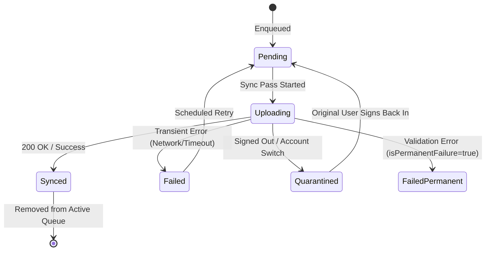

# RoadSense — Offline Queue & Synchronization Architecture (Module 06)

**Project:** RoadSense — Crowd-Sourced Road Hazard Detection and Navigation  
**Firebase Project:** `roadsense-cc1f5`  
**Module:** Module 06 — Persistent Offline Queue & Synchronization  
**Component:** `lib/sync.dart`, `lib/backend.dart`  
**Tests:** `test/persistent_sync_queue_test.dart`, `test/sync_test.dart`

---

## 1. Overview & Objectives

In mobile environments, network connectivity is intermittent. Users detecting road hazards, submitting manual hazard reports, or streaming accelerometer/gyroscope readings may lose connectivity at any time.

Module 06 provides a reliable, persistent, local-first offline queue and synchronization framework that:
1. **Guarantees Local Persistence**: Stores pending records locally to survive app restarts, process termination, and device power cycles.
2. **Enforces Multi-Account Isolation**: Prevents cross-account data leaks. Queued items are tagged with the creator's `ownerUid`. On sign-out or account switch, items are **quarantined**, never uploaded under another user's session, and **never silently discarded**.
3. **Guarantees Idempotent Uploads**: Uses deterministic IDs for all queued items so retried operations do not create duplicate Firestore records.
4. **Prevents Concurrent Upload Collisions**: Features a concurrency lock (`_uploading`) preventing overlapping sync passes.
5. **Classifies Failure Modes**: Distinguishes transient network errors (eligible for bounded retry) from permanent validation failures (`isPermanentFailure`, excluded from automatic retry loops to prevent battery/data drain).
6. **Reacts to Connectivity Changes**: Listens to network connectivity events and automatically triggers sync when the device transitions from offline to online.

---

## 2. Queue Schema & Item Structure

### 2.1 Supported Operation Types

The queue supports three distinct operation types via `SyncOperationType`:

| Operation Type | Payload Domain Model | Firestore Destination |
| :--- | :--- | :--- |
| `SyncOperationType.sensorReading` | `SensorReading` | `trips/{tripId}/sensor_readings` |
| `SyncOperationType.userReport` | `UserReport` | `reports/{reportId}` |
| `SyncOperationType.hazardObservation`| `HazardObservation` | `hazards/{hazardId}/observations` |

### 2.2 `PendingSyncItem` JSON Schema

Queue items are serialized to JSON with full backward compatibility (schema versioning). Legacy queue files lacking `type` or `ownerUid` automatically default to `SyncOperationType.sensorReading` and `ownerUid: null`.

```json
{
  "id": "report_1729740000_abc123",
  "type": "userReport",
  "data": {
    "id": "report_1729740000_abc123",
    "reporterUserId": "firebase_uid_abc123",
    "hazardType": "pothole",
    "severity": 4,
    "location": {
      "latitude": 12.971598,
      "longitude": 77.594562,
      "accuracy": 3.2
    },
    "description": "Deep pothole after monsoon rain",
    "createdAt": "2026-10-24T09:00:00.000Z"
  },
  "state": "pending",
  "attempts": 0,
  "lastAttempt": null,
  "lastError": null,
  "isPermanentFailure": false,
  "ownerUid": "firebase_uid_abc123",
  "createdAt": "2026-10-24T09:00:00.000Z",
  "schemaVersion": 1
}
```

### 2.3 Item Lifecycle States (`SyncState`)



- **`pending`**: Ready to be uploaded in the next sync pass.
- **`uploading`**: Currently being transferred to Firestore.
- **`synced`**: Successfully acknowledged by Firestore; removed from pending queue.
- **`failed`**: Transient network failure; eligible for exponential backoff retry up to `maxAttempts`.
- **`quarantined`**: Held in isolation because the active user does not match `ownerUid`.

---

## 3. Account Isolation & Quarantine Policy

In crowdsourced hazard detection, observations and reports are tied to user reputation and attribution. Uploading a previous user's sensor readings or hazard reports under a new session violates user privacy and data provenance.

### Quarantine Rules
1. **Attribution**: Every enqueued record is stamped with `ownerUid: activeUserId`.
2. **Account Switch / Logout**:
   - Calling `syncService.setActiveUser(newUserId)` triggers an immediate audit of all queued items.
   - Any item where `item.ownerUid != newUserId` (including when `newUserId == null` on sign-out) is transitioned to `SyncState.quarantined`.
3. **No Cross-Account Leaks**:
   - `FirebaseSyncBackend` and `SyncService` reject uploads if `item.ownerUid != null && item.ownerUid != activeUserId`.
4. **Zero Data Loss**:
   - Quarantined records are **never deleted**. They remain persisted in local storage.
   - When the user with `ownerUid` logs back in, `syncService.setActiveUser(ownerUid)` restores their items to `SyncState.pending`.

---

## 4. Idempotency, Concurrency & Retry Architecture

### 4.1 Idempotent Dispatch
- Every `PendingSyncItem` maintains an immutable `id`.
- `FirebaseSyncBackend` maps `id` to Firestore document keys:
  - `userReport`: Uses `item.id` for `reports.submit(...)`.
  - `hazardObservation`: Uses `item.id` as observation ID.
  - `sensorReading`: Uses `item.id` as the reading record key.
- If an upload request times out after Firestore has already written the record, re-transmitting the item results in an idempotent overwrite rather than a duplicate entity.

### 4.2 Concurrency Lock
- `SyncService.synchronize()` wraps the execution loop in a strict mutex (`_uploading`).
- Concurrent invocations (e.g., manual "Sync Now" button tapped while a background connectivity listener triggers) exit immediately with `SyncResult(success: true, syncedCount: 0)` without executing redundant concurrent sweeps.

### 4.3 Permanent Failure Isolation
- If a server error indicates client-side validation failure (e.g., coordinates out of range, missing required fields, or permission denied), the error is caught and flagged:
  ```dart
  item.isPermanentFailure = true;
  item.state = SyncState.failed;
  ```
- Subsequent `synchronize()` passes explicitly skip items where `item.isPermanentFailure == true`. This prevents infinite retry storms and saves device battery and bandwidth.

---

## 5. Connectivity Integration

The `ConnectivityService` abstraction defines:
- `Future<bool> get isOnline;`
- `Stream<ConnectivityStatus> get statusStream;`

`SyncService` subscribes to `connectivity.statusStream`:
- When status switches to `ConnectivityStatus.online`, `synchronize()` is automatically invoked.
- When status is `ConnectivityStatus.offline`, background sync passes are postponed, conserving battery.

---

## 6. Verification & Test Suite

The implementation is verified by the following test suites:

### 6.1 `test/persistent_sync_queue_test.dart` (10 tests)
1. **Restart survival**: Validates that enqueued reports, observations, and readings persist across storage restarts.
2. **Malformed JSON fallback**: Validates graceful fallback to empty queue when reading corrupted storage files.
3. **Duplicate prevention**: Validates that identical IDs are not duplicated in the queue.
4. **Temporary failure retry**: Verifies attempt incrementing and retry eligibility on transient network errors.
5. **Permanent failure isolation**: Verifies that items marked `isPermanentFailure` are skipped in subsequent sync passes.
6. **Concurrency locking**: Verifies that parallel calls to `synchronize()` do not cause overlapping uploads.
7. **Account isolation & quarantine**: Verifies that logging out or switching users quarantines non-matching items.
8. **No silent deletion of quarantined items**: Verifies that quarantined items remain intact in storage across passes.
9. **Connectivity auto-sync**: Verifies that `statusStream` transitions trigger automated synchronization.
10. **`FirebaseSyncBackend` integration**: Verifies end-to-end dispatch of reports, observations, and sensor readings to `RoadSenseBackend`.

### 6.2 Full Test Suite
Run tests with:
```bash
flutter test --no-pub
```
All **144 tests** across the repository pass without regressions.

---

## 7. Scope Boundaries & Next Steps

- **Completed**: Module 01 (Config), Module 02 (Auth), Module 03 (Schema Models), Module 04 (Repositories), Module 05 (Security Rules), Module 06 (Offline Queue & Sync).
- **Out of Scope (Module 07)**: Cross-module UI integration, live sensor hardware fusion, background Android WorkManager service bindings, and deployment of security rules to live production.
